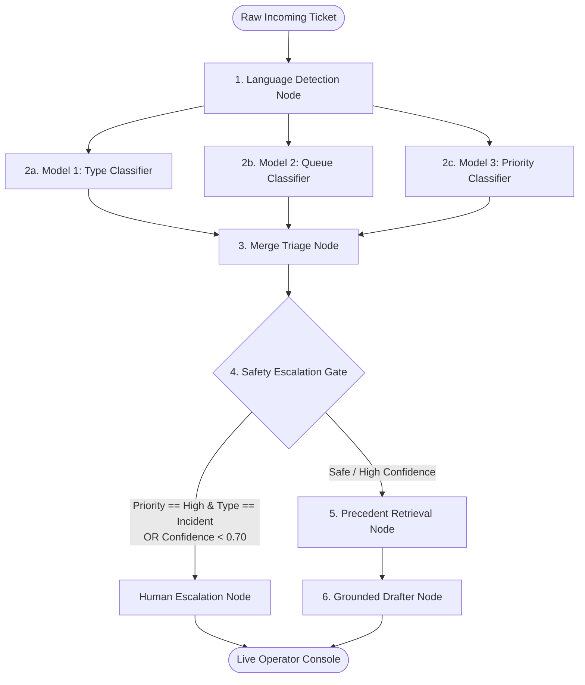

# SentinelDesk

> **Autonomous Multilingual Incident Triage, Smart Escalation & Grounded Resolution Copilot**  
> Built for enterprise technical operations with zero-leakage RAG and deterministic safety guardrails.

---

## Executive Summary

Enterprise IT helpdesks face two critical challenges:
1. **Triage Bottlenecks**: High-severity outages are buried in unstructured ticket queues alongside low-priority requests.
2. **LLM Hallucinations**: Generative AI models routinely invent non-existent policies, SLA guarantees, or unsafe troubleshooting advice.

**SentinelDesk** addresses both using an agentic **LangGraph** pipeline:
- **Instant Triage**: Classifies incoming tickets into `type`, `queue`, and `priority` with confidence scoring.
- **Safety Escalation Gate**: Intercepts high-severity incidents or low-confidence predictions, routing them directly to human on-call engineers.
- **Precedent-Grounded RAG**: Retrieves historical resolutions from past tickets and synthesizes draft replies strictly grounded in cited Ticket IDs (supporting both English and German).

---

## Architecture & Workflow

SentinelDesk is implemented as a deterministic, concurrent state graph:



### Graph Execution Path:
1. **`detect_language`**: Dynamically detects the input language using character n-grams.
2. **Concurrent Triage (Fan-Out)**:
   - **`classify_type`**: Dedicated BERT model predicting `type` (`Incident`, `Request`, `Problem`, `Change`).
   - **`classify_queue`**: Dedicated BERT model predicting department queue.
   - **`classify_priority`**: Dedicated BERT model predicting `priority` (`high`, `medium`, `low`).
3. **`merge_triage` (Fan-In)**: Collects the concurrent predictions and computes the calibrated aggregate confidence.
4. **`safety_gate` (Conditional Edge)**:
   - **Escalates immediately** if `priority == high` AND `type == Incident`.
   - **Escalates immediately** if aggregate confidence falls below `0.70`.
5. **`retrieval_node`**: Queries the historical training KB (80% split) for top-k relevant precedents using semantic similarity.
6. **`drafter_node`**: Synthesizes a response in the requester's detected native language citing retrieved Ticket IDs (e.g., `[Reference: TKT-01055]`).
7. **`human_escalation_node`**: Prepares an incident summary badge and routes to on-call engineering.

---

## Repository Structure

```
.
├── app.py                      # Live Streamlit Operator Console
├── graph.py                    # LangGraph StateGraph & Node Definitions
├── pipeline.py                 # Standalone pipeline interface & language utils
├── data_loader.py              # Ingestion, 80/20 split & zero-leakage locking
├── requirements.txt            # Project dependencies
├── contracts/                  # Teammate function specifications & interfaces
│   └── team_contracts.md       # Exact signatures for triage, retrieval, and drafter
├── findings/                   # Investigation logs & experiment findings
│   └── 01_data_and_eda_findings.md # Dataset analysis & edge cases
└── data/                       # Local data directory (Parquet files)
    ├── kb_train.parquet        # 80% split: Historical Knowledge Base (49,412 rows)
    ├── test_holdout.parquet    # 20% split: Unseen Holdout Test (12,353 rows)
    └── sample_ui_presets.json  # Pre-configured test cases for live judging
```

---

## Quickstart Guide

### 1. Environment Setup
```bash
# Clone the repository
git clone <repo-url>
cd <repo-folder>

# Create and activate virtual environment
python3 -m venv .venv
source .venv/bin/activate

# Install dependencies
pip install -r requirements.txt
```

### 2. Ingest Data & Generate 80/20 Split
```bash
python data_loader.py
```
*Locks `kb_train.parquet` (80%) and `test_holdout.parquet` (20%) deterministically.*

### 3. Launch the Live Console
```bash
streamlit run app.py
```
Open [http://localhost:8501](http://localhost:8501) in your browser.

---

## Core Deliverables & Technical Specifications

| Component | Responsibility | Key Metric / Target |
| :--- | :--- | :--- |
| **Multi-Task Triage** | Predicts `type`, `queue`, `priority`, `confidence` | Target: Macro-F1 across classes; High-Priority Incident Recall |
| **Escalation Gate** | Deterministic rule check for risk mitigation | Zero false negatives on critical infrastructure outages |
| **Grounded RAG** | Vector retrieval over historical resolutions | Strict citation of `ticket_id`; no ungrounded SLA/pricing claims |
| **Live Console** | Operator UI for real-time ticket inspection | Sub-100ms end-to-end processing latency |

---

## Zero Data Leakage Guarantee

To maintain ML integrity and adhere to evaluation rules:
1. **Split Boundary**: The dataset (`Tobi-Bueck/customer-support-tickets`, 61,765 rows) is split deterministically (`random_state=42`) into:
   - **Knowledge Base (`kb_train.parquet`)**: 49,412 rows (80%). Allowed for classifier training and vector index creation.
   - **Evaluation Holdout (`test_holdout.parquet`)**: 12,353 rows (20%). **Never indexed into vector stores or seen during inference.**
2. **Missing Value Resilience**: ~8.7% of tickets contain null `subject` lines. The ingestion pipeline and triage nodes format input as `f"{subject or ''} {body}".strip()` to prevent runtime exceptions.

---

## Judge Testing Guide (Live Demo)

When demonstrating in `app.py`, use the **Load Sample Ticket** selector to showcase key scenarios:

1. **Critical Server Outage**:
   - *Behavior*: Predicted as `Incident` / `high` priority.
   - *Outcome*: Triggers red `STATUS: ESCALATE TO ON-CALL ENGINEER` badge with paged response.
2. **Multilingual German Inquiry**:
   - *Behavior*: Automatically detects German (`de`).
   - *Outcome*: Generates grounded German draft citing past resolution ticket IDs.
3. **Missing Subject Line**:
   - *Behavior*: Evaluates full message body without crashing on null subjects.
   - *Outcome*: Correctly categorized and processed.
