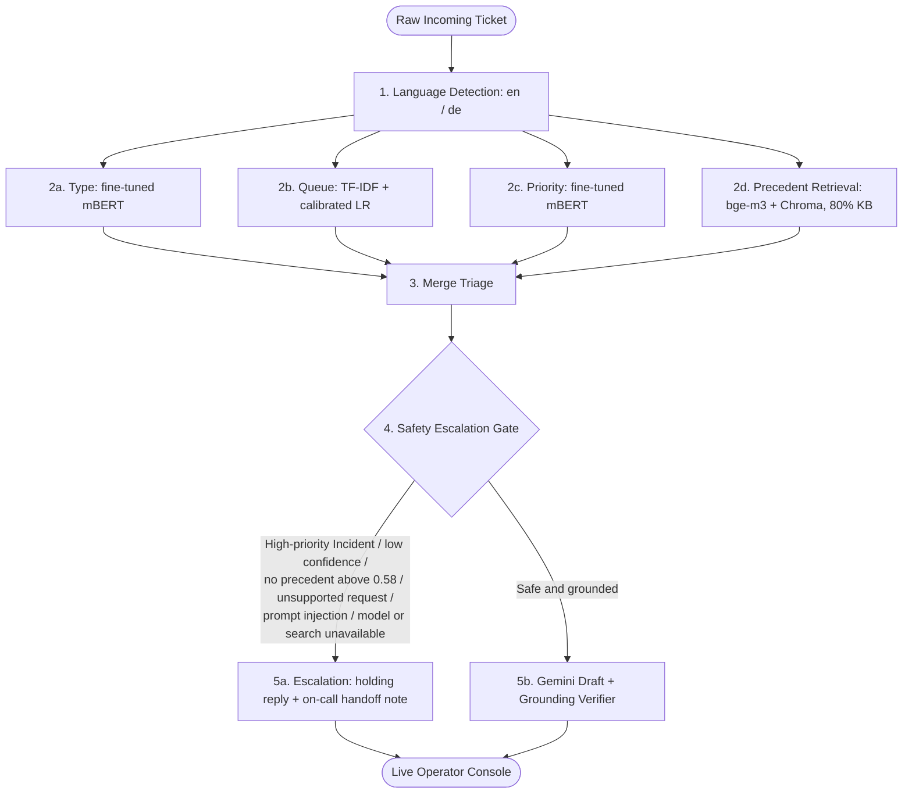

# SentinelDesk

> **Autonomous Multilingual Incident Triage, Smart Escalation & Grounded Resolution Copilot**  
> Built for enterprise technical operations with zero-leakage RAG and deterministic safety guardrails.

---

## Executive Summary

Enterprise IT helpdesks face two critical challenges:
1. **Triage Bottlenecks**: High-severity outages are buried in unstructured ticket queues alongside low-priority requests.
2. **LLM Hallucinations**: Generative AI models routinely invent non-existent policies, SLA guarantees, or unsafe troubleshooting advice.

**SentinelDesk** addresses both using an agentic **LangGraph** pipeline:
- **Instant Triage**: Classifies incoming tickets into `type`, `queue`, and `priority` with calibrated confidence scores.
- **Safety Escalation Gate**: Routes high-priority incidents, low-confidence predictions, out-of-scope tickets with no historical precedent, unsupported refund/compensation/guarantee/legal requests and prompt-injection attempts to a human.
- **Precedent-Grounded RAG**: Retrieves the most similar resolved tickets (cross-lingual, English and German) and drafts a reply in the requester's language that cites those ticket IDs.
- **Grounding Verifier**: Blocks any LLM draft that cites a ticket that was not retrieved, states a number that is not in the evidence, or promises a refund, compensation or guarantee that no precedent supports.

---

## Architecture & Workflow

SentinelDesk is implemented as a deterministic, concurrent state graph:



### Graph Execution Path:
1. **`detect_language`**: Deterministic English/German detection (seeded `langdetect`, clamped to `en`/`de`, stop-word fallback).
2. **Concurrent fan-out** (four parallel nodes):
   - **`classify_type`**: fine-tuned multilingual BERT predicting `type` (`Incident`, `Request`, `Problem`, `Change`).
   - **`classify_queue`**: TF-IDF + logistic regression over the 10 support queues (`models/queue/`). A transformer checkpoint placed in `models/queue/` takes precedence automatically.
   - **`classify_priority`**: fine-tuned multilingual BERT predicting `priority` (`high`, `medium`, `low`).
   - **`retrieve`**: top-k (default 3) most similar resolved tickets from the 80% knowledge base (`retriever.py`, BAAI/bge-m3 embeddings in Chroma). Tickets without a recorded answer are never returned. English and German precedents are matched across languages.
3. **`merge_triage` (fan-in)**: aggregate routing confidence = 0.40 × type + 0.35 × queue + 0.25 × priority.
4. **`safety_gate`**: every rule lives in `safety_gate.py` (see the table below). The node records `escalation_status`, `escalation_reason`, `escalation_triggers`, the best precedent similarity and any unsupported requests in state.
5. **`draft`** (auto-draft path): `drafter.py` masks PII, asks Gemini for a reply in the requester's language using only the retrieved precedents, and runs the grounding verifier. A rejected draft is retried once with the verifier's findings, then replaced by an extractive draft built directly from the precedent text. Without an API key the extractive draft is used.
6. **`escalate`** (human path): a holding reply in the requester's language with no claims or promises, plus an internal handoff note listing the real retrieved precedents for the on-call engineer.

### Safety gate rules (`safety_gate.py`)

| Trigger | Escalates when | Setting |
| :--- | :--- | :--- |
| `high_priority_incident` | predicted `priority == high` and `type == Incident` | always |
| `low_confidence` | aggregate confidence below threshold | `SENTINEL_CONFIDENCE_THRESHOLD` (0.65) |
| `low_similarity` | no precedent, or best precedent cosine similarity below threshold (out of scope) | `SENTINEL_SIMILARITY_THRESHOLD` (0.58) |
| `unsupported_request` | ticket asks for a refund, compensation or guarantee that none of the retrieved resolutions covers, or threatens legal action (en + de patterns in `guardrails.py`) | always |
| `prompt_injection` | ticket tries to override the assistant's instructions | always |
| `retrieval_unavailable` | precedent search failed (no mock fallback) | always |
| `classifier_unavailable` | a model could not load and a keyword fallback was used | `SENTINEL_ESCALATE_ON_FALLBACK` (true) |
| `missing_prediction` / `gate_error` | incomplete triage output or an error inside the gate | always |

The similarity threshold was calibrated on historical tickets and hand-written queries, not on the holdout: off-topic questions score 0.33-0.55, realistic in-scope tickets 0.60-0.80, and historical neighbours have a median of 0.88.

### Grounding verifier (`drafter.verify_draft`)

An LLM draft is accepted only if it:
- cites at least one ticket ID, and only IDs that were actually retrieved;
- contains no number that does not appear in the evidence; prices, percentages and durations must come from the precedents, never from the (untrusted) ticket, so an injected "90% off within 24 hours" cannot pass;
- contains no link, email address or phone number that the precedents do not contain;
- makes no refund, compensation, guarantee, discount or legal commitment that the precedents affirmatively document. Negation only counts when it directly precedes the term in the same clause ("we cannot guarantee" is a refusal; "no worries, we will refund you" is a commitment), and a precedent that refused a refund is not support for one;
- is written in the requester's language and has no unfilled template placeholders.

Tests: `python -m unittest discover -s tests -v`

---

## Triage Training Progress

1. **Built the workflow and operator console.** The first LangGraph version used keyword rules and fixed confidence values to exercise the three parallel classification nodes and escalation path.
2. **Locked the shared data split.** The training notebooks pin the full Hugging Face dataset revision and reproduce the seed-42 split of **49,412 historical tickets** and **12,353 holdout tickets**. They use subject and body as the classifier inputs and handle blank subjects. The priority run maps `critical` to `high` and `very_low` to `low`. The type run excludes historical rows with missing type labels.
3. **Fine-tuned and verified two checkpoints.** Type and priority each started from `google-bert/bert-base-multilingual-cased` with a fresh classification head. Each Colab run first trained, saved, reloaded, and ran inference on a small sample. The full runs then fine-tuned for one epoch on a T4 GPU.
4. **Integrated real predictions.** The three graph nodes call the predictor functions in [`triage_engine.py`](triage_engine.py). The type and priority archives are versioned with Git LFS. Local smoke tests exercised both trained models through LangGraph with English and German inputs, including a blank subject, and verified the review path when the queue model is unavailable.
5. **Trained the queue classifier** ([`train_queue.py`](train_queue.py)). The dataset's third CSV (`dataset-tickets-german_normalized_50_5_2.csv`, ~10.6k historical rows) has no `type` or `answer` and uses a foreign queue taxonomy ("Food & Drink/Groceries", ...), so it is excluded, leaving 38,819 historical tickets across the 10 support queues. TF-IDF (word 1-2 grams + character 3-5 grams) with class-balanced logistic regression beat logistic regression on bge-m3 embeddings by a wide margin on validation (0.651 vs 0.344 macro-F1). `C` was swept on validation; a temperature fitted on a separate calibration slice lowers the expected calibration error from 0.069 to 0.040. The model is 9 MB (`models/queue/queue_classifier.joblib`, metadata in `queue_classifier.json`).

### Historical validation results

| Classifier | Fit rows | Validation rows | Calibration rows | Macro-F1 | Class recall |
| --- | ---: | ---: | ---: | ---: | --- |
| Type | 31,055 | 3,882 | 3,882 | **80.81%** | **88.96%** for `Incident` |
| Priority | 39,529 | 4,941 | 4,942 | **57.09%** | **54.42%** for `high` |
| Queue | 34,937 | 3,882 | 3,882 | **65.07%** | **72.2%** for `Service Outages and Maintenance` |

These results use validation subsets from the historical 80%. Holdout results are in the next section and in [`findings/02_holdout_evaluation.md`](findings/02_holdout_evaluation.md).

### How prediction confidence works

Each classifier produces one raw score (logit) per class. A **temperature** fitted on a separate historical calibration subset (saved in `triage_metadata.json` for the BERT models and `queue_classifier.json` for the queue model) rescales the logits before the softmax, and the probability of the predicted class is the confidence score.

LangGraph combines the three scores into a weighted routing score (0.40 type, 0.35 queue, 0.25 priority) and sends tickets below `SENTINEL_CONFIDENCE_THRESHOLD` (0.65) to human review. Macro-F1 and recall are evaluation metrics computed across many tickets.

---

## Repository Structure

```
.
├── server.py                   # Operator console server (Starlette JSON API + static UI)
├── static/                     # Console UI: index.html, styles.css, app.js (no build step)
├── explain.py                  # Highlights and queue-model explanations for the console
├── app.py                      # Previous Streamlit console (fallback)
├── graph.py                    # LangGraph StateGraph & Node Definitions
├── triage_engine.py            # Loads the classifiers and predicts calibrated scores
├── retriever.py                # bge-m3 + Chroma precedent search over the 80% KB
├── safety_gate.py              # All escalation rules
├── guardrails.py               # Sensitive-request, prompt-injection and PII detectors
├── drafter.py                  # Gemini drafting + grounding verifier + extractive fallback
├── burst.py                    # Live outage / burst detection
├── text_utils.py               # Language detection and ticket text formatting
├── train_queue.py              # Trains the queue classifier (historical split only)
├── evaluate.py                 # Holdout evaluation (writes findings/02_holdout_evaluation.md)
├── compare_queue_models.py     # TF-IDF vs mBERT queue model on unseen historical tickets
├── pipeline.py                 # Legacy standalone pipeline (uses the shared gate)
├── data_loader.py              # Ingestion, pinned dataset revision, 80/20 split, demo presets
├── validate_gemini.py          # CLI validation tool for Gemini API key
├── requirements.txt            # Pinned dependencies (Python 3.12-3.14)
├── tests/                      # Unit + graph integration tests
├── contracts/                  # Teammate function specifications & interfaces
│   └── team_contracts.md       # Exact signatures for triage, retrieval, and drafter
├── findings/                   # Investigation logs & experiment findings
│   ├── 01_data_and_eda_findings.md # Dataset analysis & edge cases
│   ├── 02_holdout_evaluation.md    # Holdout metrics (generated by evaluate.py)
│   └── 03_queue_model_comparison.md # Queue model selection (generated by compare_queue_models.py)
├── chroma_dbs/                 # Prebuilt Chroma index of the 49,412 historical tickets (Git LFS)
├── models/                     # Classifier weights
│   ├── type/                   # Model 1: mBERT, Incident, Request, Problem, Change (Git LFS)
│   ├── queue/                  # Model 2: TF-IDF + logistic regression, 10 queues
│   └── priority/               # Model 3: mBERT, High, Medium, Low (Git LFS)
└── data/                       # Local data directory (Parquet files)
    ├── kb_train.parquet        # 80% split: Historical Knowledge Base (49,412 rows)
    ├── test_holdout.parquet    # 20% split: Unseen Holdout Test (12,353 rows)
    └── sample_ui_presets.json  # Pre-configured test cases for live judging
```

---

## Quickstart Guide

Follow these exact steps to run the project from scratch on any machine:

### 1. Environment Setup

Install Git LFS to retrieve the tracked model archives. See [model setup](models/README.md) for the checkpoint paths.

```bash
git lfs install
git clone <repo-url>
cd <repo-folder>
git lfs pull

# Create and activate a Python 3.12 virtual environment
# (the pinned requirements have no wheels for Python 3.15 yet)
python3.12 -m venv .venv
source .venv/bin/activate

# Install dependencies
pip install -r requirements.txt
```

### 2. Configure Environment Variables (Optional for Live Gemini API)
```bash
cp .env.example .env
# Open .env and add your GEMINI_API_KEY:
# GEMINI_API_KEY=your_actual_key_here
```
*(If no API key is provided, the system automatically runs in offline mode using deterministic local precedent templates).*

### 3. Verify API Key Connection (Optional)
```bash
python validate_gemini.py
```

### 4. Ingest Data & Lock 80/20 Split
```bash
python data_loader.py
```
*Downloads the official Hugging Face dataset at a pinned revision and locks `kb_train.parquet` (80%) and `test_holdout.parquet` (20%) deterministically. The ticket IDs match the prebuilt Chroma index.*

### 5. (Optional) Retrain the queue classifier and re-run the evaluation
```bash
python train_queue.py          # ~2 min on a laptop CPU
python evaluate.py --full      # holdout metrics -> findings/02_holdout_evaluation.md
```

### 6. Launch the Operator Console
```bash
python server.py
```
Open [http://localhost:8000](http://localhost:8000). The first start loads the models and index (~15 s, and a one-time ~2.2 GB download of BAAI/bge-m3); after that a ticket takes about 80 ms without the LLM. The previous Streamlit console still works as a fallback: `streamlit run app.py`.

The console has three views:
- **Triage**: paste a ticket or pick a sample. Shows the decision and plain-language reasons, calibrated confidence per model, the words that drove the queue choice, a **pipeline trace** (per-node timing waterfall), the draft with each grounding check, the similar resolved tickets with a similarity bar against the threshold, and highlights of sensitive requests, injection attempts and personal data in the ticket. Operators can **approve, edit, escalate or correct** the triage; every decision is stored PII-masked in `data/feedback.jsonl` for the next training round.
- **Plain chatbot comparison** (switch in Triage): the same ticket answered by Gemini with no retrieval and no checks, with our grounding check listing what it invented.
- **Live inbox**: unseen holdout tickets (subject and message only) are triaged as they arrive, with live counts, a department breakdown, and an **Inject an outage** button that triggers the major-outage banner.
- **Evaluation**: holdout metrics, F1 per class, the queue model comparison, and an interactive **safety vs workload** chart of the confidence threshold.

### Demo scenarios (Load Benchmark Scenario)
- **Holdout tickets**: critical incident, German ticket, routine request, empty subject.
- **Hospital VPN Outage**: the problem-statement scenario, escalated to on-call.
- **Refund + Legal Threat**: blocked as an unsupported request.
- **Prompt Injection Attempt**: blocked.
- **Out-of-Scope Request**: no precedent above the similarity threshold, escalated.
- **Ticket with PII**: email, phone and account number are masked before the LLM call.
- **Outage Burst 1/3 to 3/3**: process all three (two English, one German) and the third raises the **Major Incident Outage** banner.

---

## Quantitative Evaluation Results (Holdout Test Split)

`python evaluate.py --full --e2e 200 --llm 20` on all 12,353 tickets of the 20% unseen holdout (`data/test_holdout.parquet`). Models see only subject + body; the holdout `answer` column is dropped at load and the index holds 0 holdout tickets. Full report: [`findings/02_holdout_evaluation.md`](findings/02_holdout_evaluation.md).

| Target | Metric | Score | Rows scored |
| :--- | :--- | ---: | ---: |
| **Type** (4 classes) | Macro-F1 | **0.803** | 9,768 labelled |
| **Priority** (3 classes) | Macro-F1 | **0.560** | 12,353 |
| **Queue** (10 support queues) | Macro-F1 | **0.670** | 9,768 |
| **High-Priority Incident Recall** | Strict: predicted `Incident` + `high` | **60.4%** | 1,692 |
| **High-Priority Incident Recall** | Escalation: routed to a human by the gate | **79.2%** | 1,692 |
| Escalation rate (triage rules only) | Share of all tickets sent to a human | 52.0% | 12,353 |
| End-to-end latency (200-ticket sample) | p50 / p95 per ticket incl. retrieval and drafting | **80 ms / 860 ms** | 200 |
| Grounding verifier | Auto-drafts that pass (9 live Gemini + 82 extractive) | **100%** | 91 |

Per-class F1: Type: Incident 0.80, Request 0.99, Problem 0.47, Change 0.96. Priority: high 0.62, medium 0.61, low 0.45. Queue: from 0.59 (IT Support) to 0.85 (Billing and Payments). Batched CPU cost: 10.6 ms (type) + 10.2 ms (priority) + 0.4 ms (queue) per ticket. The p95 latency is dominated by the live Gemini calls.

The queue model was chosen on historical data, not the holdout: on 776 historical tickets that neither candidate saw, TF-IDF + logistic regression scored 0.661 macro-F1 vs 0.230 for the 52-label mBERT checkpoint ([`findings/03_queue_model_comparison.md`](findings/03_queue_model_comparison.md), `python compare_queue_models.py`).

The weakest link is priority: the gate escalates 79% of true high-priority incidents, but 21% are predicted as `medium`/`low` with confident scores and auto-drafted. The confidence threshold trades this off against workload (`findings/threshold_tradeoff.json`, chart in the console): at 0.75, 94.5% of urgent incidents reach a person while 78% of all tickets are escalated; at the 0.65 default, 79.2% and 52.0%.

---

## Data Split and Holdout Protocol

To maintain ML integrity and adhere to evaluation rules:
1. **Split Boundary**: The dataset (`Tobi-Bueck/customer-support-tickets`, 61,765 rows) is split deterministically (`random_state=42`) into:
   - **Knowledge Base (`kb_train.parquet`)**: 49,412 rows (80%). Allowed for classifier training and vector index creation.
   - **Evaluation Holdout (`test_holdout.parquet`)**: 12,353 rows (20%). Final inference uses only the subject and body. Labels are used afterward for scoring. Holdout answers stay out of retrieval and model inputs.
2. **Missing Value Resilience**: ~8.7% of historical tickets have null subjects. The BERT type and priority tokenizers receive an empty subject in those cases and retain the message body.
3. **Pinned revision**: `data_loader.py` loads dataset revision `ddf1c81a5475992c4fa6752bf1e8b4e31f07bbeb`, the same revision used to train the checkpoints and build the index.
4. **Index check**: `evaluate.py` reads the Chroma index before scoring and aborts if any holdout `ticket_id` is indexed (current overlap: 0 of 12,353), and drops the holdout `answer` column as soon as the file is loaded.

## Bonus Features

- **Cross-lingual precedent matching**: bge-m3 embeds English and German into one space, so a German ticket retrieves English resolutions (and vice versa) while the reply is written in the requester's language.
- **Live outage / burst detection** (`burst.py`): tickets processed in the last 30 minutes are compared with each new ticket; three or more describing the same failure (cosine ≥ 0.72, any language) raise a Major Incident Outage banner.
- **PII guardrail** (`guardrails.mask_pii`): emails, phone numbers, IP addresses, IBANs, card and account numbers are replaced with placeholders before ticket text is sent to Gemini.


